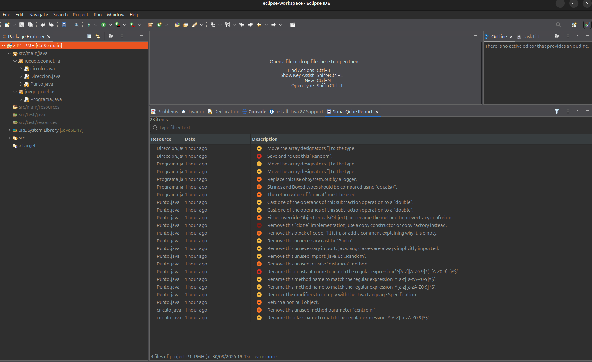
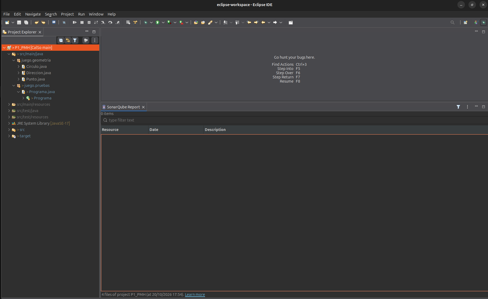

# Práctica 1 — Revisiones estáticas de código con SonarQube for Eclipse

## 1. Miembros del grupo

| Miembro | Nombre y apellidos |
|---|---|
| Alumno | Pablo Meroño Herranz |

**Nombre del proyecto Eclipse:** `P1_PMH`

---

## 2. Análisis inicial

Antes de realizar ninguna modificación sobre el código proporcionado se ha ejecutado el análisis estático del proyecto utilizando **SonarQube for Eclipse** con su configuración por defecto.

### Captura inicial



---

## 3. Disconformidades detectadas

En el análisis inicial se han identificado las siguientes disconformidades:

| Nº | Regla Sonar | Archivo | Línea | Disconformidad |
|---:|---|---|---:|---|
| 1 | `java:S1197` | `Direccion.java` | 19 | Move the array designators [] to the type. |
| 2 | `java:S2119` | `Direccion.java` | 21 | Save and re-use this "Random". |
| 3 | `java:S1197` | `Programa.java` | 7 | Move the array designators [] to the type. |
| 4 | `java:S1197` | `Programa.java` | 10 | Move the array designators [] to the type. |
| 5 | `java:S106` | `Programa.java` | 20 | Replace this use of System.out by a logger. |
| 6 | `java:S4973` | `Programa.java` | 18 | Strings and Boxed types should be compared using "equals()". |
| 7 | `java:S2201` | `Programa.java` | 16 | The return value of "concat" must be used. |
| 8 | `java:S2184` | `Punto.java` | 117 | Cast one of the operands of this subtraction operation to a "double". |
| 9 | `java:S2184` | `Punto.java` | 117 | Cast one of the operands of this subtraction operation to a "double". |
| 10 | `java:S1201` | `Punto.java` | 126 | Either override Object.equals(Object), or rename the method to prevent any confusion. |
| 11 | `java:S2975` | `Punto.java` | 136 | Remove this "clone" implementation; use a copy constructor or copy factory instead. |
| 12 | `java:S108` | `Punto.java` | 143 | Remove this block of code, fill it in, or add a comment explaining why it is empty. |
| 13 | `java:S1905` | `Punto.java` | 130 | Remove this unnecessary cast to "Punto". |
| 14 | `java:S1128` | `Punto.java` | 3 | Remove this unnecessary import: java.lang classes are always implicitly imported. |
| 15 | `java:S1128` | `Punto.java` | 4 | Remove this unused import 'java.util.Random'. |
| 16 | `java:S1144` | `Punto.java` | 116 | Remove this unused private "distancia" method. |
| 17 | `java:S115` | `Punto.java` | 11 | Rename this constant name to match the regular expression '^[A-Z][A-Z0-9]*(_[A-Z0-9]+)*$'. |
| 18 | `java:S100` | `Punto.java` | 51 | Rename this method name to match the regular expression '^[a-z][a-zA-Z0-9]*$'. |
| 19 | `java:S100` | `Punto.java` | 82 | Rename this method name to match the regular expression '^[a-z][a-zA-Z0-9]*$'. |
| 20 | `java:S1124` | `Punto.java` | 11 | Reorder the modifiers to comply with the Java Language Specification. |
| 21 | `java:S2225` | `Punto.java` | 145 | Return a non null object. |
| 22 | `java:S1172` | `circulo.java` | 10 | Remove this unused method parameter "centroIni". |
| 23 | `java:S101` | `circulo.java` | 3 | Rename this class name to match the regular expression '^[A-Z][a-zA-Z0-9]*$'. |
| 24 | `java:S1206` | `Punto.java` | 127 | This class overrides "equals()" and should therefore also override "hashCode()". |

---

## 4. Soluciones adoptadas

### Disconformidad 1 — `java:S1197`

**Localización:** `src/main/java/juego/geometria/Direccion.java`, línea 19  
**Responsable:** Pablo Meroño Herranz  
**Commit:**

**Problema detectado**

Los corchetes del array están colocados en la variable en lugar del tipo de dato.

**Solución adoptada**

Se han movido los corchetes [] para que acompañen al tipo de dato (Direccion[]).

---

### Disconformidad 2 — `java:S2119`

**Localización:** `src/main/java/juego/geometria/Direccion.java`, línea 21  
**Responsable:** Pablo Meroño Herranz  
**Commit:** 

**Problema detectado**

Se instancia un nuevo objeto Random cada vez que se ejecuta el método.

**Solución adoptada**

Se extrae la instanciación de Random convirtiéndola en un atributo private static final de la clase para que se reutilice.

---

### Disconformidad 3 — `java:S1197`

**Localización:** `src/main/java/juego/pruebas/Programa.java`, línea 7  
**Responsable:** Pablo Meroño Herranz  
**Commit:**

**Problema detectado**

Los corchetes del array están colocados en la variable en lugar del tipo de dato.

**Solución adoptada**

Se han movido los corchetes para que acompañen al tipo de dato (String[] args).

---

### Disconformidad 4 — `java:S1197`

**Localización:** `src/main/java/juego/pruebas/Programa.java`, línea 10  
**Responsable:** Pablo Meroño Herranz  
**Commit:** 

**Problema detectado**

Los corchetes del array están colocados junto al nombre de la variable (puntos[]).

**Solución adoptada**

Se han movido los corchetes para que acompañen al tipo de dato (Punto[] puntos).

---

### Disconformidad 5 — `java:S106`

**Localización:** `src/main/java/juego/pruebas/Programa.java`, línea 20  
**Responsable:** Pablo Meroño Herranz  
**Commit:** 

**Problema detectado**

Se utiliza System.out para mostrar texto por consola, esto no es seguro ni escalable.

**Solución adoptada**

Se ha sustituido System.out.println() por la clase estandarizada java.util.logging.Logger empleando el nivel info().

---

### Disconformidad 6 — `java:S4973`

**Localización:** `src/main/java/juego/pruebas/Programa.java`, línea 21  
**Responsable:** Pablo Meroño Herranz  
**Commit:** 

**Problema detectado**

Se comparan cadenas de texto (Strings) usando el operador ==, el cual compara referencias en memoria en lugar del contenido.

**Solución adoptada**

Se sustituye info == "" por el método info.equals("") para comparar correctamente su contenido.

---

### Disconformidad 7 — `java:S2201`

**Localización:** `src/main/java/juego/pruebas/Programa.java`, línea 19  
**Responsable:** Pablo Meroño Herranz  
**Commit:** 

**Problema detectado**

El valor devuelto por el método .concat() no se estaba asignando a ninguna variable, perdiéndose el resultado de la concatenación debido a la inmutabilidad de los Strings.

**Solución adoptada**

Se reasigna el resultado de la operación a la propia variable modificando la instrucción a info = info.concat(punto.toString());.

---

### Disconformidades 8 y 9 — `java:S2184`

**Localización:** `src/main/java/juego/geometria/Punto.java`, línea 117  
**Responsable:** Pablo Meroño Herranz  
**Commit:** 

**Problema detectado**

Se realiza una resta con aritmética de enteros antes de pasar el resultado a un método que espera un double, lo que puede generar pérdida de precisión.

**Solución adoptada**

Se ha añadido un cast explícito a double a uno de los operandos de cada resta ((double) this.x y (double) this.y) para forzar la aritmética de punto flotante.

---

### Disconformidades 10 y 13 — `java:S1201 y java:S1905`

**Localización:** `src/main/java/juego/geometria/Punto.java`, línea 126 y 130  
**Responsable:** Pablo Meroño Herranz  
**Commit:** 

**Problema detectado**

El método equals recibía un objeto de tipo Punto en lugar de Object (no sobrescribiendo el original) y su lógica interna contenía un cast redundante.

**Solución adoptada**

Al reescribir la firma a equals(Object obj) y ajustar su lógica de validación, se han solucionado ambas disconformidades con la misma modificación atómica. Nota: Esta corrección hace aflorar una nueva disconformidad que será la número 24 (regla java:S1206, que se resolverá en el siguiente ciclo).

---

### Disconformidad 24 — `java:S1206`

**Localización:** `src/main/java/juego/geometria/Punto.java`, línea 127  
**Responsable:** Pablo Meroño Herranz  
**Commit:** 

**Problema detectado**

La clase sobrescribía el método equals() pero no sobrescribía el método hashCode(), incumpliendo el contrato de Java que exige que ambos estén implementados para garantizar el correcto funcionamiento en colecciones.

**Solución adoptada**

Se ha implementado el método hashCode() utilizando java.util.Objects.hash(x, y) para generar un código basado en los mismos atributos que se usan en la comparación.

---

### Disconformidades 11, 12 y 21 — `java:S2975, java:S108 y java:S2225`

**Localización:** `src/main/java/juego/geometria/Punto.java`, línea 144, 151 y 153  
**Responsable:** Pablo Meroño Herranz  
**Commit:** 

**Problema detectado**

El método clone() es una mala práctica (se recomienda constructor de copia), contenía un bloque catch que silenciaba excepciones y, además, finalizaba devolviendo un valor null explícito.

**Solución adoptada**

Se ha eliminado por completo el método clone(), ya que la clase dispone de un constructor de copia adecuado. Esta única modificación atómica elimina a la vez la mala práctica del clon, el bloque vacío y el retorno nulo.

---

### Disconformidad 14 — `java:S1128`

**Localización:** `src/main/java/juego/geometria/Punto.java`, línea 3  
**Responsable:** Pablo Meroño Herranz  
**Commit:** 

**Problema detectado**

Se importaba explícitamente la clase Math del paquete java.lang, lo cual es innecesario porque Java importa este paquete de forma implícita.

**Solución adoptada**

Se ha eliminado la línea del import redundante.

---

### Disconformidad 15 — `java:S1128`

**Localización:** `src/main/java/juego/geometria/Punto.java`, línea 4  
**Responsable:** Pablo Meroño Herranz  
**Commit:** 

**Problema detectado**

Se importaba la clase java.util.Random pero no se utilizaba en ninguna parte del código de la clase.

**Solución adoptada**

Se ha eliminado la declaración de importación no utilizada.

---

## 5. Resumen de las correcciones

| Nº | Regla Sonar | Responsable | Commit | Resultado |
|---:|---|---|---|---|
| 1 | `java:SXXXX` | Nombre y apellidos | `abcdef1` | Resuelta |
| 2 | `java:SXXXX` | Nombre y apellidos | `abcdef2` | Resuelta |
| 3 | `java:SXXXX` | Nombre y apellidos | `abcdef3` | Resuelta |

---

## 6. Análisis final

Una vez realizadas todas las modificaciones se ha vuelto a ejecutar el análisis del proyecto completo con **SonarQube for Eclipse**.

### Captura final



La captura final permite comprobar que se está analizando el mismo proyecto utilizado en la captura inicial y que ya no quedan disconformidades pendientes.

---

## 7. Proyecto final

La versión final del proyecto Eclipse se encuentra en:

```text
P1/proyecto/P1_INICIALES/
```

El proyecto incluido en esta carpeta contiene las modificaciones correspondientes a las soluciones documentadas anteriormente y coincide con la versión sobre la que se ha realizado la captura final.

---

## 8. Comprobación de la entrega

- [ ] El nombre del proyecto sigue el formato establecido: `P1_INICIALES`.
- [ ] Se identifican los dos miembros del grupo.
- [ ] Se incluye la captura del análisis inicial.
- [ ] Se han documentado todas las disconformidades inicialmente detectadas.
- [ ] Cada solución está asociada a un commit identificable en `main`.
- [ ] Se identifica qué miembro del grupo realizó cada corrección.
- [ ] Los dos miembros han participado mediante commits propios.
- [ ] Se incluye la captura del análisis final.
- [ ] La captura final permite comprobar que no quedan disconformidades.
- [ ] Se ha incorporado el proyecto Eclipse final dentro de `P1/proyecto/`.
- [ ] El proyecto final corresponde al código analizado en la captura final.
