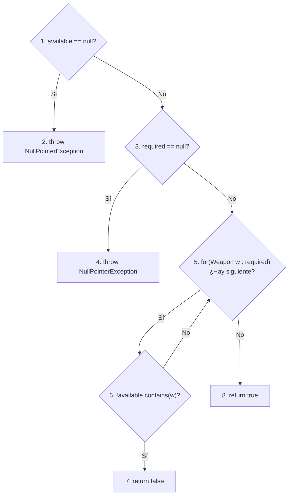
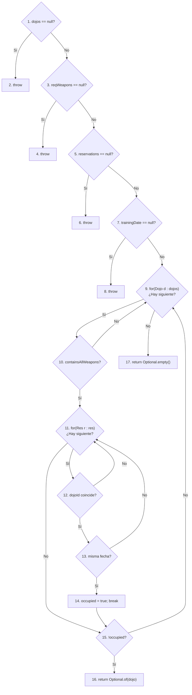
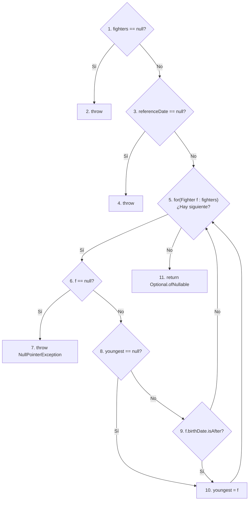
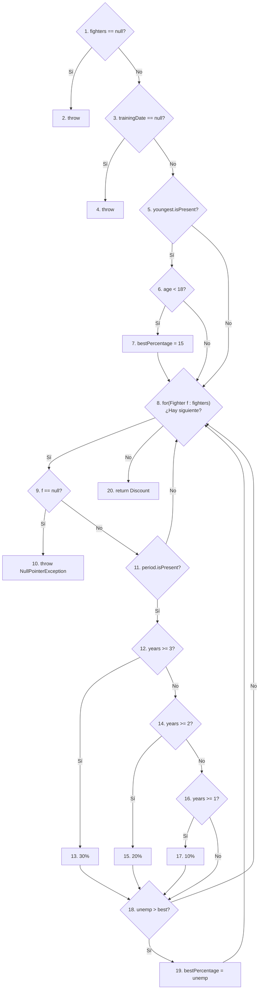

# Práctica 3. Diseño y ejecución de pruebas de software de caja blanca y de caja negra

**Asignatura:** Calidad del Software · Curso 2026–2027  
**Caso de estudio:** Dojo Reservation

---

## Resolución del grupo

### Identificación
- **Alumno (Desarrollo individual):** Pablo Meroño Herranz
- **Responsabilidades:** Diseño e implementación íntegra de pruebas de caja blanca (Caminos independientes y Cobertura de condiciones para los 4 métodos de dominio), diseño e implementación de pruebas de caja negra E2E (Selenium para Pantallas de Búsqueda y Coste), análisis de calidad (JaCoCo y PIT) y corrección de defectos.
- **Ramas utilizadas:** Desarrollo íntegro sobre `main`.

---
### Actividad 1 · Pruebas de caja blanca

#### 1.1 Caminos independientes

A continuación se presentan los grafos de flujo diseñados para calcular la complejidad ciclomática $V(G)$. *Nota: Las condiciones compuestas (`&&`, `||`) se han separado en nodos de decisión independientes.*

##### 🔹 Grafo 1: `containsAllRequiredWeapons` (V(G) = 5)

 

##### 🔹 Grafo 2: `findFirstAvailableDojo` (V(G) = 11)

 

##### 🔹 Grafo 3: `findYoungestFighter` (V(G) = 7)

 

##### 🔹 Grafo 4: `calculateBestDiscount` (V(G) = 12)

*(La notación `1→...→9` indica que se atraviesan las comprobaciones iniciales de nulos evaluando a falso).*

| Método | Nodo o camino identificado | Datos de entrada y fecha | Resultado esperado según especificación | Nombre del test | Resultado ejecución |
|---|---|---|---|---|---|
| `containsAllRequiredWeapons` | C1: 1→2 | `available = null`, `required = {}` | `NullPointerException` ("Available weapons...") | `testGivenAvailableNullWhenContainsAllThenThrowsException` | Verde (Éxito) |
| `containsAllRequiredWeapons` | C2: 1→3→4 | `available = {}`, `required = null` | `NullPointerException` ("Required weapons...") | `testGivenRequiredNullWhenContainsAllThenThrowsException` | Verde (Éxito) |
| `containsAllRequiredWeapons` | C3: 1→3→5→8 | `available = {Bokken}`, `required = {}` | `true` (todas presentes, incluye cero) | `testGivenRequiredEmptyWhenContainsAllThenReturnsTrue` | Verde (Éxito) |
| `containsAllRequiredWeapons` | C4: 1→3→5→6→7 | `available = {}`, `required = {Katana}` | `false` (falta Katana) | `testGivenAvailableEmptyWhenContainsAllThenReturnsFalse` | Verde (Éxito) |
| `containsAllRequiredWeapons` | C5: 1→3→5→6→5→8 | `available = {Bokken}`, `required = {Katana}` | `false` según la especificación (no contiene Katana) | `testGivenMissingWeaponWhenContainsAllThenReturnsFalse` | Verde (Éxito) |
| `findFirstAvailableDojo` | C6: 1→2 | `dojos=null`, resto válido | `NullPointerException` ("Dojos are required") | `testGivenDojosNullWhenFindFirstThenThrowsException` | Verde (Éxito) |
| `findFirstAvailableDojo` | C7: 1→3→4 | `reqWeapons=null`, resto válido | `NullPointerException` ("Required weapons...") | `testGivenWeaponsNullWhenFindFirstThenThrowsException` | Verde (Éxito) |
| `findFirstAvailableDojo` | C8: 1→3→5→6 | `reservations=null`, resto válido | `NullPointerException` ("Reservations are...") | `testGivenReservationsNullWhenFindFirstThenThrowsException` | Verde (Éxito) |
| `findFirstAvailableDojo` | C9: 1→...→7→8 | `date=null`, resto válido | `NullPointerException` ("Training date...") | `testGivenDateNullWhenFindFirstThenThrowsException` | Verde (Éxito) |
| `findFirstAvailableDojo` | C10: 1→...→9(No)→17 | `dojos={}`, resto válido | `Optional.empty()` | `testGivenEmptyDojosWhenFindFirstThenReturnsEmpty` | Verde (Éxito) |
| `findFirstAvailableDojo` | C11: 1→...→9(Sí)→10(No)→9(No)→17 | `dojos={D1(sin armas)}` | `Optional.empty()` | `testGivenDojoWithoutWeaponsWhenFindFirstThenReturnsEmpty` | Verde (Éxito) |
| `findFirstAvailableDojo` | C12: 1→...→9(Sí)→10(Sí)→11(No)→15(Sí)→16 | `dojos={D1(con armas)}`, `res={}` | `Optional.of(D1)` | `testGivenDojoOkAndNoReservationsWhenFindFirstThenReturnsDojo` | Verde (Éxito) |
| `findFirstAvailableDojo` | C13: 1→...→11(Sí)→12(No)→11(No)→15(Sí)→16 | `D1`, `res={R1(para D2)}` | `Optional.of(D1)` | `testGivenDojoOkAndReservationForOtherWhenFindFirstThenReturnsDojo` | Verde (Éxito) |
| `findFirstAvailableDojo` | C14: 1→...→12(Sí)→13(Sí)→14→15(No)→9(No)→17 | `D1`, `res={R1(para D1, misma fecha)}` | **Esperado:** `Optional.empty()` (Ocupado) | `testGivenDojoOkAndReservationSameDateWhenFindFirstThenReturnsEmpty` | Verde (Éxito) |
| `findFirstAvailableDojo` | C15: 1→...→12(Sí)→13(No)→11(No)→15(Sí)→16 | `D1`, `res={R1(para D1, distinta fecha)}` | **Esperado:** `Optional.of(D1)` (Libre) | `testGivenDojoOkAndReservationDiffDateWhenFindFirstThenReturnsDojo` | Verde (Éxito) |
| `findFirstAvailableDojo` | C16: 1→...→14→15(No)→9(Sí D2)→10(Sí)→11(No)→15(Sí)→16 | `dojos={D1, D2}`, res en D1 | `Optional.of(D2)` (Avanza iteración) | `testGivenFirstDojoOccupiedReturnsSecondDojo` | Verde (Éxito) |
| `findYoungestFighter` | C17: 1→2 | `fighters = null`, fecha válida | `NullPointerException` ("Fighters are required") | `testGivenFightersNullWhenFindYoungestThenThrowsException` | Verde (Éxito) |
| `findYoungestFighter` | C18: 1→3→4 | `fighters = {}`, `refDate = null` | `NullPointerException` ("Reference date is required") | `testGivenRefDateNullWhenFindYoungestThenThrowsException` | Verde (Éxito) |
| `findYoungestFighter` | C19: 1→3→5(No)→11 | `fighters = {}` | `Optional.empty()` | `testGivenEmptyFightersWhenFindYoungestThenReturnsEmpty` | Verde (Éxito) |
| `findYoungestFighter` | C20: 1→...→5(Sí)→6(Sí)→7 | `fighters = {null}` | `NullPointerException` ("Null fighter") | `testGivenNullFighterWhenFindYoungestThenThrowsException` | Verde (Éxito) |
| `findYoungestFighter` | C21: 1→...→6(No)→8(Sí)→10→5(No)→11 | `fighters = {F1(2000)}` | `Optional.of(F1)` (Asigna primer elemento) | `testGivenOneFighterWhenFindYoungestThenReturnsFighter` | Verde (Éxito) |
| `findYoungestFighter` | C22: 1→...→10→5(Sí F2)→6(No)→8(No)→9(Sí)→10→...→11 | `fighters = {F1(1990), F2(2000)}` | **Esperado:** `Optional.of(F2)` | `testGivenSecondYoungerWhenFindYoungestThenReturnsSecond` | Verde (Éxito) |
| `findYoungestFighter` | C23: 1→...→10→5(Sí F2)→6(No)→8(No)→9(No)→5(No)→11 | `fighters = {F1(2000), F2(1990)}` | `Optional.of(F1)` | `testGivenSecondOlderWhenFindYoungestThenReturnsFirst` | Verde (Éxito) |
| `calculateBestDiscount`| C24: 1→2 | `fighters = null`, fecha válida | `NullPointerException` ("Fighters are required") | `testGivenFightersNullWhenCalculateDiscountThenThrowsException`| Verde (Éxito) |
| `calculateBestDiscount`| C25: 1→3→4 | `fighters = {}`, `date = null` | `NullPointerException` ("Training date is required") | `testGivenDateNullWhenCalculateDiscountThenThrowsException` | Verde (Éxito) |
| `calculateBestDiscount`| C26: 1→...→5(No)→8(No)→20 | `fighters = {}` | `Discount(0)` | `testGivenEmptyFightersWhenCalculateDiscountThenReturnsZero` | Verde (Éxito) |
| `calculateBestDiscount`| C27: 1→...→5(Sí)→6(No)→8(Sí)→9(No)→11(No)→8(No)→20 | `F1(age=20, unemp=null)` | `Discount(0)` | `testGivenAdultNoUnemploymentWhenCalculateThenReturnsZero` | Verde (Éxito) |
| `calculateBestDiscount`| C28: 1→...→5(Sí)→6(Sí)→7→8(Sí)→9(No)→11(No)→8(No)→20 | `F1(age=16, unemp=null)` | `Discount(15)` | `testGivenMinorNoUnemploymentWhenCalculateThenReturnsFifteen`| Verde (Éxito) |
| `calculateBestDiscount`| C29: 1→...→8(Sí)→9(Sí)→10 | N/A | **Inviable:** `findYoungest` lanza excepción antes. | N/A (Camino no factible documentado) | Verde (Éxito) |
| `calculateBestDiscount`| C30: 1→...→11(Sí)→12(No)→14(No)→16(No)→18(No)→8(No)→20 | `F1(age=20, unemp=0.5 yrs)` | `Discount(0)` | `testGivenAdultUnemploymentUnderOneYearThenReturnsZero` | Verde (Éxito) |
| `calculateBestDiscount`| C31: 1→...→14(No)→16(Sí)→17(10%)→18(Sí)→19→8(No)→20 | `F1(age=20, unemp=1 yr)` | `Discount(10)` | `testGivenAdultUnemploymentOneYearThenReturnsTen` | Verde (Éxito) |
| `calculateBestDiscount`| C32: 1→...→12(No)→14(Sí)→15(20%)→18(Sí)→19→8(No)→20 | `F1(age=20, unemp=2 yrs)` | **Esperado:** `Discount(20)` | `testGivenAdultUnemploymentTwoYearsThenReturnsTwenty` | Verde (Éxito) |
| `calculateBestDiscount`| C33: 1→...→12(No)→14(Sí)→15(20%)→18(Sí)→19→8(No)→20 | `F1(age=20, unemp=2.5 yrs)`| `Discount(20)` | `testGivenAdultUnemploymentOverTwoYearsThenReturnsTwenty` | Verde (Éxito) |
| `calculateBestDiscount`| C34: 1→...→11(Sí)→12(Sí)→13(30%)→18(Sí)→19→8(No)→20 | `F1(age=20, unemp=3 yrs)` | `Discount(30)` | `testGivenAdultUnemploymentThreeYearsThenReturnsThirty` | Verde (Éxito) |
| `calculateBestDiscount`| C35: 1→...→16(Sí)→17(10%)→18(No)→8(No)→20 | `F1(age=17, unemp=1 yr)` | `Discount(15)` (Juventud > Paro) | `testGivenMinorUnemploymentOneYearThenReturnsFifteen` | Verde (Éxito) |

#### 1.2 Cobertura de condiciones seleccionadas

| Condición atómica | Caso que evalúa verdadero | Caso que evalúa falso | Casos adicionales | Justificación si no es factible |
|---|---|---|---|---|
| `findFirstAvailableDojo`: dojo.getId().equals(reservation.dojoId()) | C14 / C15 evalúan verdadero (mismo dojo). | C13 evalúa falso (distinto dojo). | No requeridos (ya cubiertos). | Factible. Cuando es falso (C13), el cortocircuito impide evaluar la siguiente condición. |
| `findFirstAvailableDojo`: trainingDate.equals(reservation.trainingDate()) | C14 evalúa verdadero (misma fecha). | C15 evalúa falso (distinta fecha). | No requeridos (ya cubiertos). | Factible. Se evalúa solo cuando la condición anterior es verdadera. |
| `findYoungestFighter`: youngest == null | C21 (1ª iteración de cualquier lista no vacía). | C22 / C23 (2ª iteración cuando la lista tiene 2+ luchadores). | No requeridos. | Factible. Inicialmente es nulo, y luego pasa a falso el resto del bucle. |
| `findYoungestFighter`: fighter.birthDate().isAfter(...) | C22 evalúa verdadero. | C23 evalúa falso. | No requeridos. | Factible. Solo se evalúa a partir de la segunda iteración, ya que en la primera el `youngest == null` provoca un cortocircuito. |

---
### Actividad 2 · Caja negra con Selenium (E2E)

#### 2.1 Clases de equivalencia

| Código de clase | Variable | Condición de pertenencia | Válida / inválida | Comportamiento exigido |
|---|---|---|---|---|
| CE-T1 | `teamId` | Identificador de equipo existente en el sistema | Válida | Permite realizar la búsqueda o cálculo de coste. |
| CE-T2 | `teamId` | Cadena vacía o nula | Inválida | Muestra error: `Team id is required`. |
| CE-T3 | `teamId` | Identificador que no existe (ej. EQ-999) | Inválida | Muestra error: `Team does not exist`. |
| CE-DJ1 | `dojoId` | Identificador de dojo existente en el sistema | Válida | Permite realizar el cálculo de coste. |
| CE-DJ2 | `dojoId` | Cadena vacía o nula | Inválida | Muestra error: `Dojo id is required`. |
| CE-DJ3 | `dojoId` | Identificador que no existe (ej. D-999) | Inválida | Muestra error: `Dojo does not exist`. |
| CE-D1 | `trainingDate` | Fecha estrictamente posterior a la actual | Válida | Permite realizar la búsqueda o cálculo de coste. |
| CE-D2 | `trainingDate` | Fecha igual o anterior a la actual | Inválida | Muestra error: `Training date must be in the future`. |

#### 2.2 Tabla de casos E2E
*(Nota: En la automatización se han utilizado fechas dinámicas mediante `LocalDate.now()`).*

| ID del caso | Clases cubiertas | URL concreta utilizada | Resultado único esperado | Nombre prueba | Resultado Final |
|---|---|---|---|---|---|
| E2E-1 | CE-T1, CE-D1 | `/dojos?teamId=EQ-001&trainingDate=[HOY+10]` | Tabla de dojos visible, localiza dojo compatible y libre | `testGivenValidTeamAndFutureDateWhenSearchThenDisplaysDojos` | Verde (Éxito) |
| E2E-2 | CE-T2, CE-D1 | `/dojos?trainingDate=[HOY+10]` | Error: `Team id is required` | `testGivenEmptyTeamWhenSearchThenDisplaysError` | Verde (Éxito) |
| E2E-3 | CE-T3, CE-D1 | `/dojos?teamId=EQ-999&trainingDate=[HOY+10]` | Error: `Team does not exist` | `testGivenInvalidTeamWhenSearchThenDisplaysError` | Verde (Éxito) |
| E2E-4 | CE-T1, CE-D2 | `/dojos?teamId=EQ-001&trainingDate=[HOY-5]` | Error: `Training date must be in the future` (Valor límite inferior) | `testGivenPastDateWhenSearchThenDisplaysError` | Verde (Éxito) |
| E2E-5 | CE-T1, CE-D2 | `/dojos?teamId=EQ-001&trainingDate=[HOY]` | Error: `Training date must be in the future` (Valor límite exacto) | `testGivenTodayDateWhenSearchThenDisplaysError` | Verde (Éxito) |
| E2E-6 | CE-T1, CE-DJ1, CE-D1 | `/coste?teamId=EQ-001&dojoId=D-001&trainingDate=[HOY+10]` | Muestra precios desglosados (base, armas, subtotal, descuento y final) | `testGivenValidInputsWhenCalculateCostThenDisplaysPrices` | Verde (Éxito) |
| E2E-7 | CE-T1, CE-DJ2, CE-D1 | `/coste?teamId=EQ-001&dojoId=&trainingDate=[HOY+10]` | Error: `Dojo id is required` | `testGivenEmptyDojoWhenCalculateCostThenDisplaysError` | Verde (Éxito) |
| E2E-8 | CE-T1, CE-DJ3, CE-D1 | `/coste?teamId=EQ-001&dojoId=D-999&trainingDate=[HOY+10]` | Error: `Dojo does not exist` | `testGivenInvalidDojoWhenCalculateCostThenDisplaysError` | Verde (Éxito) |

#### 2.3 Análisis de valores límite

| Variable | Valor del límite | Valor elegido (Dinámico) | Expectativas |
|---|---|---|---|
| `trainingDate` | Fecha actual (`LocalDate.now()`) | `LocalDate.now().minusDays(5)` (Pasado) | Inválido. Error: `Training date must be in the future`. |
| `trainingDate` | Fecha actual (`LocalDate.now()`) | `LocalDate.now()` (Hoy) | Inválido. Error: `Training date must be in the future`. |
| `trainingDate` | Fecha actual (`LocalDate.now()`) | `LocalDate.now().plusDays(10)` (Futuro) | Válido. La aplicación procesa la solicitud. |

---
### Actividad 3 · Defectos detectados y corregidos

| Síntoma | Prueba que lo detectó | Causa | Corrección | Regresión posterior |
|---|---|---|---|---|
| Retorna `true` aunque falten armas | `testGivenMissingWeaponWhenContainsAllThenReturnsFalse` | En `containsAllRequiredWeapons`, el bucle no verifica si `available.contains(weapon)`. Solo comprueba si la colección disponible está vacía. | Modificado el interior del bucle a `if (!available.contains(weapon)) { return false; }`. | El test pasa a verde. No se ven afectadas otras pruebas. |
| Un dojo se marca como ocupado en días libres, y libre en días ocupados | `testGivenDojoOkAndReservationSameDateWhenFindFirstThenReturnsEmpty` y `testGivenDojoOkAndReservationDiffDate...` | En `findFirstAvailableDojo`, la condición evalúa `!reservation.trainingDate().equals(trainingDate)`. | Se eliminó la negación `!`, quedando: `reservation.trainingDate().equals(trainingDate)`. | Los tests de reserva en mismo día y distinto día pasan a verde. |
| El descuento por 2 años de paro aplica el tramo de 1 año (10%) en vez del 20% | `testGivenAdultUnemploymentTwoYearsThenReturnsTwenty` | En `calculateBestDiscount`, el tramo de 20% utiliza `> 2` en lugar de `>= 2`. | Se cambió `else if (completeYears > 2)` por `else if (completeYears >= 2)`. | El test de valor límite de 2 años ahora aplica el 20% y pasa a verde. |
| Calcula al luchador más viejo en lugar del más joven | `testGivenSecondYoungerWhenFindYoungestThenReturnsSecond` | En `findYoungestFighter`, la comparación de juventud usa el método `isBefore` para la fecha de nacimiento. | Se cambió `fighter.birthDate().isBefore(...)` a `isAfter(...)`. | El test identifica correctamente al nacido más tarde (más joven). |
| **Defecto UI/Web:** El sistema no muestra los errores de validación si no se envía un equipo o dojo en el formulario. | `testGivenEmptyTeamWhenSearchThenDisplaysError` y E2E-7 | El `DojoReservationController` enmascaraba el error al inyectar `defaultValue = "EQ-001"` y `"D-002"` en los `@RequestParam`, evitando que los valores nulos/vacíos llegaran al Dominio. | Modificados los parámetros a `@RequestParam(name = "teamId", required = false)` eliminando los valores por defecto. | Los tests E2E-2 y E2E-7 pasan a verde y el sistema ya valida correctamente mostrando los errores en pantalla. |

---
### Herramientas de calidad

- **Comandos usados:** `mvn clean verify`, `mvn -Pe2e clean verify`, `mvn -Pmutation test pitest:mutationCoverage`.
- **Pruebas superadas:** 35/35 tests de caja blanca (JUnit 5) superados con éxito + 8/8 tests E2E (Selenium/Chrome) superados con éxito.
- **JaCoCo (Interpretación):** Cobertura de ramas e instrucciones al 100% en casi todo el dominio. La única excepción justificada es `ReservationDiscountService` (97% en ramas).
- **PIT (Interpretación):** Análisis de mutación completado con un Test Strength del 95% (36/38 mutantes eliminados).
- **Compatibilidad:** Se utilizó Java 25 y Maven 3.9.12 sobre Linux. No se registraron problemas insalvables de compatibilidad con JUnit 5 o ChromeDriver.
---
### Vídeo de síntesis

- **Enlace al vídeo externo (oculto/no listado):** https://youtu.be/n3L7rWU1RUA
- **Contenido explicado:** Se documenta de forma concisa el flujo de CI, la ejecución en verde de toda la suite de pruebas (35 unitarias y 8 E2E automatizadas), la interpretación de los reportes de calidad JaCoCo, y la explicación de los defectos encontrados en el código (como el problema de los años de paro y el comportamiento enmascarador del controlador).