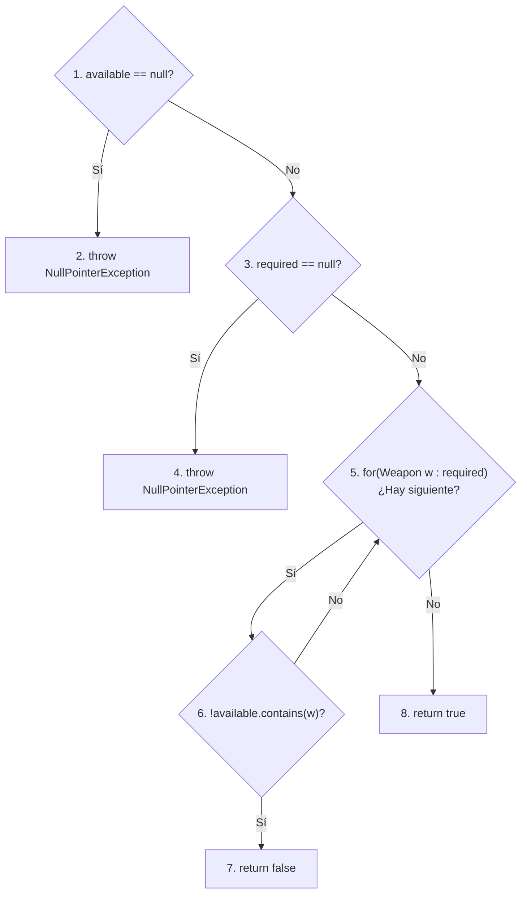
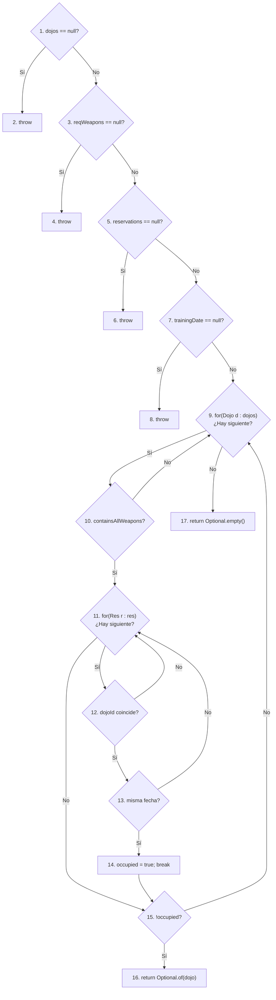
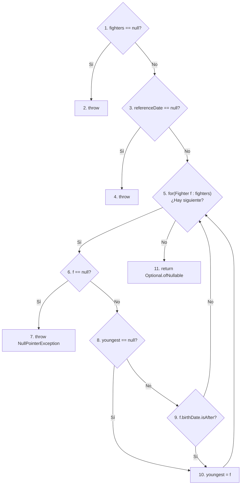
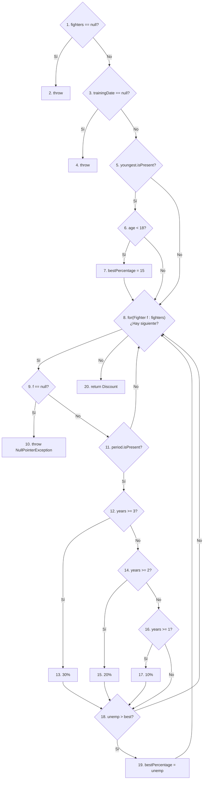

# Práctica 3. Diseño y ejecución de pruebas de software de caja blanca y de caja negra

**Asignatura:** Calidad del Software · Curso 2026–2027  
**Caso de estudio:** Dojo Reservation

## 1. Descripción general

El Ayuntamiento de una localidad gestiona la asignación de dojos para entrenamientos de equipos de cinco luchadores y el cálculo de su coste en la gestión de campeonatos de artes marciales. La aplicación está implementada en Java y dispone de dos páginas web: **búsqueda de dojos** y **cálculo del coste**.

El objetivo general es comprobar el comportamiento programado mediante técnicas de **caja blanca** (caminos independientes y cobertura de condiciones seleccionadas) y de **caja negra** (clases de equivalencia y análisis de valores límite), analizar resultados de calidad y justificar las correcciones de los defectos incluidos en las clases de estudio.

El documento [especificación funcional](docs/ESPECIFICACION.md) es la referencia para identificar los resultados esperados en el proceso de prueba; la [guía técnica y de pruebas](docs/GUIA_PRUEBAS.md) describe el uso de JUnit 5, Selenium y Maven.

## 2. Reparto y responsabilidades

Si la práctica es realizada por un único alumno deberá implementar el total de las pruebas de todos los ficheros propuestos para realizar las pruebas y deberá realizar la entrega completa de la práctica. En el caso de grupos formados por dos miembros se deberá seguir el siguiente reparto de responsabilidades:

| Integrante | Caja blanca: métodos de dominio | Caja negra: interfaz |
|---|---|---|
| **Alumno 1** | `containsAllRequiredWeapons` y `DojoSearchService.findFirstAvailableDojo`  | Búsqueda de dojos (`/dojos`) |
| **Alumno 2** | `ReservationDiscountService.findYoungestFighter` y `calculateBestDiscount` | Costes y bonificaciones (`/coste`) |

Cada estudiante es responsable del **diseño, implementación, ejecución, análisis y corrección** de su parte. Ambos deben comprender la integración final, revisar las aportaciones del compañero y garantizar una regresión conjunta.

## 3. Actividad 1 · Pruebas de caja blanca

Las pruebas de caja blanca integran **dos técnicas en un mismo proceso**: diseño de caminos independientes y cobertura de condiciones. Estas pruebas deben completarse íntegramente antes de iniciar las pruebas de caja negra.

### Diseño de caminos independientes

Para cada uno de los dos métodos asignados a cada participante (todos los métodos para los grupos de un único participante) se realizarán los siguinetes pasos:

1. Construir el grafo de flujo con nodos, aristas, decisiones, bucles, retornos y excepciones relevantes.
2. Calcular, mediante las tres fórmulas vistas en clase de teoría, la complejidad ciclomática.
3. Identificar una base de caminos independientes y estudiar su factibilidad, justificando los recorridos imposibles.
4. Proponer los datos concretos, fechas y resultados esperados según la especificación, asociándolos a cada camino.

### Diseño de cobertura de condiciones

Después de la fase anterior y **antes de implementar los tests**, cada integrante analizará una decisión compuesta asignada (para los grupos formados por un único participante se analizarán las dos condiciones):

| Integrante | Método | Decisión cuyo conjunto de condiciones se debe cubrir |
|---|---|---|
| Alumno 1 | `DojoSearchService.findFirstAvailableDojo` | La decisión del bucle de reservas que combina con `&&` la igualdad del identificador de dojo y de la fecha de entrenamiento |
| Alumno 2 | `ReservationDiscountService.findYoungestFighter` | La decisión que combina con `\|\|` la comprobación `youngest == null` y la comparación de las fechas de nacimiento |

Se identificarán las condiciones atómicas y los resultados verdadero y falso **efectivamente evaluados** en los casos ya propuestos para caminos independientes. Se tendrán en cuenta las reglas de cortocircuito de Java: una condición no evaluada no cuenta como falsa. Si faltan evaluaciones factibles, se propondrán **solo las pruebas necesarias** para cubrirlas, con sus entradas, fechas y resultados funcionales esperados. Las evaluaciones no factibles deberán justificarse. No se exige cobertura de condiciones de otras decisiones.

### Implementación y análisis de la caja blanca

Una vez completo el diseño de ambas técnicas, implementar los casos JUnit 5: un escenario y un resultado funcional principal por método de prueba, reutilizando casos cuando satisfagan ambos criterios. Ejecutar los tests, estudiar los fallos, justificar y realizar las correcciones y repetir la regresión.

Documentar por separado la **trazabilidad camino → prueba** y la **trazabilidad condición atómica/valor → prueba**.

## 4. Actividad 2 · Caja negra con Selenium

Cada integrante estudiará **su pantalla** mediante (para los grupos formados por un único participante se estudiarán las dos pantallas):

1. Identificación **previa** de las clases de equivalencia válidas e inválidas para las entradas y estados relevantes.
2. Identificación de los límites funcionales y selección de valores **antes / en / después** cuando resulte aplicable.
3. Tabla de diseño que indique **clase o límite, estado previo, entradas concretas, salida esperada y prueba**.
4. Implementación de los escenarios mediante los **archivos Selenium suministrados**. Las clases de apoyo ya incluyen navegación, ChromeDriver, espera y envío de formularios; no debéis construir esa infraestructura.
5. Ejecución en el navegador y contraste de resultados con la especificación.

Los desplegables solamente ofrecen identificadores conocidos; para comprobar un identificador inexistente podéis **abrir una URL con parámetros de petición** y verificar la respuesta de la aplicación. Esto comprueba la validación del servidor; no significa que el desplegable acepte tal entrada.

La ejecución E2E utiliza una **fecha del sistema controlada** (véase guía técnica) para que las pruebas de fechas sean repetibles.

## 5. Actividad 3 · Calidad, defectos y regresión

Una vez ejecutadas las pruebas diseñadas:

- **JaCoCo:** ejecutar el análisis local de cobertura de líneas y ramas, especialmente en los métodos objeto de prueba; explicar qué decisiones permanecen sin ejecutar.
- **GitHub Actions:** ejecutar las pruebas unitarias JUnit y publicar como artefactos sus resultados y los informes JaCoCo y PIT de los servicios de dominio. El diseño, la ejecución y el análisis de pruebas se realizan en Eclipse, sin depender de servidores de análisis externos.
- **PIT:** ejecutar localmente y explicar el análisis de mutación **sobre las pruebas unitarias de los métodos de dominio**, no sobre Selenium. Distinguir mutaciones detectadas, supervivientes y no cubiertas; no confundir la cobertura de código con la efectividad de los tests.
- **Regresión final:** repetir todas las pruebas después de cada corrección e identificar qué cambió y por qué.

No se permite eliminar tests, cambiar resultados esperados para hacerlos coincidir con defectos o desactivar controles para obtener una ejecución verde.

## 6. Entregables

El repositorio de la pareja contendrá la carpeta **`P3/`** con `README_P3.md`, el módulo Java Maven y los documentos/evidencias necesarios. El README de resolución incluirá:

| Apartado | Evidencias requeridas |
|---|---|
| Identificación | Nombre y apellidos de los dos integrantes, responsabilidades y ramas utilizadas |
| Caja blanca | Grafos, complejidad ciclomática, caminos independientes y su factibilidad; cobertura de condiciones seleccionadas, casos y resultados JUnit |
| Caja negra | Clases de equivalencia **antes** de los casos, límites, tablas de casos y resultados E2E |
| Defectos y correcciones | Síntoma, prueba que lo detectó, causa, corrección y regresión posterior |
| Herramientas de calidad | Informes locales de JaCoCo y PIT, resultados de JUnit y evidencias de GitHub Actions; interpretación de los resultados |
| Ejecución | Comandos usados, número de pruebas superadas y problemas de compatibilidad resueltos |
| Vídeo de síntesis | Enlace directo al vídeo externo, participación y explicación de un resultado concreto por integrante |

### Vídeo de síntesis de la práctica (entrega obligatoria)

Cada grupo presentará un **vídeo de síntesis de duración máxima de 7 minutos** (duración orientativa: 6–7 minutos), publicado en un servicio externo como YouTube en modo oculto/no listado. Se incorporará el enlace directo en \`P3/README_P3.md\`; **no se almacenará el vídeo en el repositorio**.

Participarán ambos integrantes (el participante si el grupo es unitario). Cada uno explicará un **resultado concreto** de sus pruebas o de sus análisis, indicando qué evidencia se obtiene, cómo se interpreta y, si existe un defecto, qué corrección se ha propuesto o aplicado. No se solicita un recorrido exhaustivo por todas las pruebas ni por todos los informes.

El vídeo mostrará la aplicación o las herramientas en funcionamiento y la interacción del ratón. Cada sección será una grabación continua de **pantalla, interacción y voz capturadas simultáneamente**; no se admite grabar las acciones y añadir posteriormente una voz en off. Se permiten transiciones entre secciones. No es obligatorio mostrar la cámara web. Deben garantizarse texto legible, audio inteligible y ausencia de ruido de fondo que dificulte la evaluación. El README recogerá las partes concretas qué explica cada participante y el enlace a la grabación.

## 7. Criterios de calidad de las pruebas

- Utilizar nombres `testGiven<EntradasYEstadoConcretos>When<Accion>Then<SalidaConcreta>`.
- No agrupar varios escenarios en un solo método ni utilizar un bucle para probar muchos casos dentro de una única prueba.
- Colocar `@Test` en su propia línea y escribir cada instrucción Java en línea separada.
- Emplear fechas explícitas en las tablas; justificar excepciones y caminos no factibles.
- Mantener la separación entre **especificación**, **diseño del test**, **ejecución** y **análisis del defecto**.
- Conservar la infraestructura preparada, las interfaces públicas y los selectores estables de las pantallas.

## 8. Material y soporte

- [Especificación funcional](docs/ESPECIFICACION.md).
- [Diagramas de arquitectura y UML del dominio](docs/DIAGRAMAS.md).
- [Guía técnica JUnit, Selenium, Maven y tablas de pruebas](docs/GUIA_PRUEBAS.md).
- [Compatibilidad de versiones y resolución de incidencias](docs/ENTORNO_Y_VERSIONES.md).
- Los informes de cobertura y mutaciones se obtienen con Maven; GitHub Actions permite comprobar la regresión y consultar sus artefactos.
- [Plantilla del workflow GitHub Actions para cada grupo](dos/GUIA_PRUEBAS.md#plantilla-de-github-actions-para-el-repositorio-del-grupo).

Las fechas de entrega y cualquier instrucción institucional adicional se comunicarán mediante el Aula Virtual

---

## Resolución del grupo

### Identificación
- **Alumno (Desarrollo individual):** Pablo Meroño Herranz
- **Responsabilidades:** Diseño e implementación íntegra de pruebas de caja blanca (Caminos independientes y Cobertura de condiciones para los 4 métodos de dominio), diseño e implementación de pruebas de caja negra E2E (Selenium para Pantallas de Búsqueda y Coste), análisis de calidad (JaCoCo y PIT) y corrección de defectos.
- **Ramas utilizadas:** Desarrollo íntegro sobre `main`.

---
### Actividad 1 · Pruebas de caja blanca

#### 1.1 Caminos independientes

A continuación se presentan los grafos de flujo diseñados para calcular la complejidad ciclomática $V(G)$. *Nota: Las condiciones compuestas (`&&`, `||`) se han separado en nodos de decisión independientes.*

##### 🔹 Grafo 1: `containsAllRequiredWeapons` (V(G) = 5)

 

##### 🔹 Grafo 2: `findFirstAvailableDojo` (V(G) = 11)

 

##### 🔹 Grafo 3: `findYoungestFighter` (V(G) = 7)

 

##### 🔹 Grafo 4: `calculateBestDiscount` (V(G) = 12)

*(La notación `1→...→9` indica que se atraviesan las comprobaciones iniciales de nulos evaluando a falso).*

| Método | Nodo o camino identificado | Datos de entrada y fecha | Resultado esperado según especificación | Nombre del test | Resultado ejecución |
|---|---|---|---|---|---|
| `containsAllRequiredWeapons` | C1: 1→2 | `available = null`, `required = {}` | `NullPointerException` ("Available weapons...") | `testGivenAvailableNullWhenContainsAllThenThrowsException` | Verde (Éxito) |
| `containsAllRequiredWeapons` | C2: 1→3→4 | `available = {}`, `required = null` | `NullPointerException` ("Required weapons...") | `testGivenRequiredNullWhenContainsAllThenThrowsException` | Verde (Éxito) |
| `containsAllRequiredWeapons` | C3: 1→3→5→8 | `available = {Bokken}`, `required = {}` | `true` (todas presentes, incluye cero) | `testGivenRequiredEmptyWhenContainsAllThenReturnsTrue` | Verde (Éxito) |
| `containsAllRequiredWeapons` | C4: 1→3→5→6→7 | `available = {}`, `required = {Katana}` | `false` (falta Katana) | `testGivenAvailableEmptyWhenContainsAllThenReturnsFalse` | Verde (Éxito) |
| `containsAllRequiredWeapons` | C5: 1→3→5→6→5→8 | `available = {Bokken}`, `required = {Katana}` | `false` según la especificación (no contiene Katana) | `testGivenMissingWeaponWhenContainsAllThenReturnsFalse` | Verde (Éxito) |
| `findFirstAvailableDojo` | C6: 1→2 | `dojos=null`, resto válido | `NullPointerException` ("Dojos are required") | `testGivenDojosNullWhenFindFirstThenThrowsException` | Verde (Éxito) |
| `findFirstAvailableDojo` | C7: 1→3→4 | `reqWeapons=null`, resto válido | `NullPointerException` ("Required weapons...") | `testGivenWeaponsNullWhenFindFirstThenThrowsException` | Verde (Éxito) |
| `findFirstAvailableDojo` | C8: 1→3→5→6 | `reservations=null`, resto válido | `NullPointerException` ("Reservations are...") | `testGivenReservationsNullWhenFindFirstThenThrowsException` | Verde (Éxito) |
| `findFirstAvailableDojo` | C9: 1→...→7→8 | `date=null`, resto válido | `NullPointerException` ("Training date...") | `testGivenDateNullWhenFindFirstThenThrowsException` | Verde (Éxito) |
| `findFirstAvailableDojo` | C10: 1→...→9(No)→17 | `dojos={}`, resto válido | `Optional.empty()` | `testGivenEmptyDojosWhenFindFirstThenReturnsEmpty` | Verde (Éxito) |
| `findFirstAvailableDojo` | C11: 1→...→9(Sí)→10(No)→9(No)→17 | `dojos={D1(sin armas)}` | `Optional.empty()` | `testGivenDojoWithoutWeaponsWhenFindFirstThenReturnsEmpty` | Verde (Éxito) |
| `findFirstAvailableDojo` | C12: 1→...→9(Sí)→10(Sí)→11(No)→15(Sí)→16 | `dojos={D1(con armas)}`, `res={}` | `Optional.of(D1)` | `testGivenDojoOkAndNoReservationsWhenFindFirstThenReturnsDojo` | Verde (Éxito) |
| `findFirstAvailableDojo` | C13: 1→...→11(Sí)→12(No)→11(No)→15(Sí)→16 | `D1`, `res={R1(para D2)}` | `Optional.of(D1)` | `testGivenDojoOkAndReservationForOtherWhenFindFirstThenReturnsDojo` | Verde (Éxito) |
| `findFirstAvailableDojo` | C14: 1→...→12(Sí)→13(Sí)→14→15(No)→9(No)→17 | `D1`, `res={R1(para D1, misma fecha)}` | **Esperado:** `Optional.empty()` (Ocupado) | `testGivenDojoOkAndReservationSameDateWhenFindFirstThenReturnsEmpty` | Verde (Éxito) |
| `findFirstAvailableDojo` | C15: 1→...→12(Sí)→13(No)→11(No)→15(Sí)→16 | `D1`, `res={R1(para D1, distinta fecha)}` | **Esperado:** `Optional.of(D1)` (Libre) | `testGivenDojoOkAndReservationDiffDateWhenFindFirstThenReturnsDojo` | Verde (Éxito) |
| `findFirstAvailableDojo` | C16: 1→...→14→15(No)→9(Sí D2)→10(Sí)→11(No)→15(Sí)→16 | `dojos={D1, D2}`, res en D1 | `Optional.of(D2)` (Avanza iteración) | `testGivenFirstDojoOccupiedReturnsSecondDojo` | Verde (Éxito) |
| `findYoungestFighter` | C17: 1→2 | `fighters = null`, fecha válida | `NullPointerException` ("Fighters are required") | `testGivenFightersNullWhenFindYoungestThenThrowsException` | |
| `findYoungestFighter` | C18: 1→3→4 | `fighters = {}`, `refDate = null` | `NullPointerException` ("Reference date is required") | `testGivenRefDateNullWhenFindYoungestThenThrowsException` | |
| `findYoungestFighter` | C19: 1→3→5(No)→11 | `fighters = {}` | `Optional.empty()` | `testGivenEmptyFightersWhenFindYoungestThenReturnsEmpty` | |
| `findYoungestFighter` | C20: 1→...→5(Sí)→6(Sí)→7 | `fighters = {null}` | `NullPointerException` ("Null fighter") | `testGivenNullFighterWhenFindYoungestThenThrowsException` | |
| `findYoungestFighter` | C21: 1→...→6(No)→8(Sí)→10→5(No)→11 | `fighters = {F1(2000)}` | `Optional.of(F1)` (Asigna primer elemento) | `testGivenOneFighterWhenFindYoungestThenReturnsFighter` | |
| `findYoungestFighter` | C22: 1→...→10→5(Sí F2)→6(No)→8(No)→9(Sí)→10→...→11 | `fighters = {F1(1990), F2(2000)}` | **Esperado:** `Optional.of(F2)` | `testGivenSecondYoungerWhenFindYoungestThenReturnsSecond` | |
| `findYoungestFighter` | C23: 1→...→10→5(Sí F2)→6(No)→8(No)→9(No)→5(No)→11 | `fighters = {F1(2000), F2(1990)}` | `Optional.of(F1)` | `testGivenSecondOlderWhenFindYoungestThenReturnsFirst` | |
| `calculateBestDiscount`| C24: 1→2 | `fighters = null`, fecha válida | `NullPointerException` ("Fighters are required") | `testGivenFightersNullWhenCalculateDiscountThenThrowsException`| |
| `calculateBestDiscount`| C25: 1→3→4 | `fighters = {}`, `date = null` | `NullPointerException` ("Training date is required") | `testGivenDateNullWhenCalculateDiscountThenThrowsException` | |
| `calculateBestDiscount`| C26: 1→...→5(No)→8(No)→20 | `fighters = {}` | `Discount(0)` | `testGivenEmptyFightersWhenCalculateDiscountThenReturnsZero` | |
| `calculateBestDiscount`| C27: 1→...→5(Sí)→6(No)→8(Sí)→9(No)→11(No)→8(No)→20 | `F1(age=20, unemp=null)` | `Discount(0)` | `testGivenAdultNoUnemploymentWhenCalculateThenReturnsZero` | |
| `calculateBestDiscount`| C28: 1→...→5(Sí)→6(Sí)→7→8(Sí)→9(No)→11(No)→8(No)→20 | `F1(age=16, unemp=null)` | `Discount(15)` | `testGivenMinorNoUnemploymentWhenCalculateThenReturnsFifteen`| |
| `calculateBestDiscount`| C29: 1→...→8(Sí)→9(Sí)→10 | N/A | **Inviable:** `findYoungest` lanza excepción antes. | N/A (Camino no factible documentado) | |
| `calculateBestDiscount`| C30: 1→...→11(Sí)→12(No)→14(No)→16(No)→18(No)→8(No)→20 | `F1(age=20, unemp=0.5 yrs)` | `Discount(0)` | `testGivenAdultUnemploymentUnderOneYearThenReturnsZero` | |
| `calculateBestDiscount`| C31: 1→...→14(No)→16(Sí)→17(10%)→18(Sí)→19→8(No)→20 | `F1(age=20, unemp=1 yr)` | `Discount(10)` | `testGivenAdultUnemploymentOneYearThenReturnsTen` | |
| `calculateBestDiscount`| C32: 1→...→12(No)→14(Sí)→15(20%)→18(Sí)→19→8(No)→20 | `F1(age=20, unemp=2 yrs)` | **Esperado:** `Discount(20)` | `testGivenAdultUnemploymentTwoYearsThenReturnsTwenty` | |
| `calculateBestDiscount`| C33: 1→...→12(No)→14(Sí)→15(20%)→18(Sí)→19→8(No)→20 | `F1(age=20, unemp=2.5 yrs)`| `Discount(20)` | `testGivenAdultUnemploymentOverTwoYearsThenReturnsTwenty` | |
| `calculateBestDiscount`| C34: 1→...→11(Sí)→12(Sí)→13(30%)→18(Sí)→19→8(No)→20 | `F1(age=20, unemp=3 yrs)` | `Discount(30)` | `testGivenAdultUnemploymentThreeYearsThenReturnsThirty` | |
| `calculateBestDiscount`| C35: 1→...→16(Sí)→17(10%)→18(No)→8(No)→20 | `F1(age=16, unemp=1 yr)` | `Discount(15)` (Juventud > Paro) | `testGivenMinorUnemploymentOneYearThenReturnsFifteen` | |

#### 1.2 Cobertura de condiciones seleccionadas

| Condición atómica | Caso que evalúa verdadero | Caso que evalúa falso | Casos adicionales | Justificación si no es factible |
|---|---|---|---|---|
| `findFirstAvailableDojo`: (dojo.getId().equals(reservation.dojoId()) | C14 / C15 evalúan verdadero (mismo dojo). | C13 evalúa falso (distinto dojo). | No requeridos (ya cubiertos). | Factible. Cuando es falso (C13), el cortocircuito impide evaluar la siguiente condición. |
| `findFirstAvailableDojo`: trainingDate.equals(reservation.trainingDate()) | C14 evalúa verdadero (misma fecha). | C15 evalúa falso (distinta fecha). | No requeridos (ya cubiertos). | Factible. Se evalúa solo cuando la condición anterior es verdadera. *(Nota: El código original tiene el bug `!equals`, pero la condición atómica en sí es factible).* |
| `findYoungestFighter`: youngest == null | C21 (1ª iteración de cualquier lista no vacía). | C22 / C23 (2ª iteración cuando la lista tiene 2+ luchadores). | No requeridos. | Factible. Inicialmente es nulo, y luego pasa a falso el resto del bucle. |
| `findYoungestFighter`: fighter.birthDate().isBefore(...) | C23 evalúa verdadero (el código busca `isBefore`). | C22 evalúa falso. | No requeridos. | Factible. Solo se evalúa a partir de la segunda iteración, ya que en la primera el `youngest == null` provoca un cortocircuito. *(Nota: El código tiene un defecto, usa isBefore en vez de isAfter, pero la evaluación de la condición sí se produce)*. |

---
### Actividad 2 · Caja negra con Selenium (E2E)

#### 2.1 Clases de equivalencia

| Código de clase | Variable | Condición de pertenencia | Válida / inválida | Comportamiento exigido |
|---|---|---|---|---|
| CE-T1 | `teamId` | Identificador de equipo existente en el sistema | Válida | Permite realizar la búsqueda o cálculo de coste. |
| CE-T2 | `teamId` | Cadena vacía o nula | Inválida | Muestra error: `Team id is required`. |
| CE-T3 | `teamId` | Identificador que no existe (ej. EQ-999) | Inválida | Muestra error: `Team does not exist`. |
| CE-DJ1 | `dojoId` | Identificador de dojo existente en el sistema | Válida | Permite realizar el cálculo de coste. |
| CE-DJ2 | `dojoId` | Cadena vacía o nula | Inválida | Muestra error: `Dojo id is required`. |
| CE-DJ3 | `dojoId` | Identificador que no existe (ej. D-999) | Inválida | Muestra error: `Dojo does not exist`. |
| CE-D1 | `trainingDate` | Fecha estrictamente posterior a la actual | Válida | Permite realizar la búsqueda o cálculo de coste. |
| CE-D2 | `trainingDate` | Fecha igual o anterior a la actual | Inválida | Muestra error: `Training date must be in the future`. |

#### 2.2 Tabla de casos E2E

| ID del caso | Clases cubiertas | Equipo/dojo/fecha o URL concreta | Estado inicial | Resultado único esperado | Nombre prueba |
|---|---|---|---|---|---|
| E2E-1 | CE-T1, CE-D1 | `/dojos?teamId=EQ-001&trainingDate=2026-10-21` | Catálogo cargado, reloj en 2026-10-20 | Tabla de dojos visible, localiza dojo compatible y libre | `testGivenValidTeamAndFutureDateWhenSearchThenDisplaysDojos` |
| E2E-2 | CE-T2, CE-D1 | `/dojos?teamId=&trainingDate=2026-10-21` | Catálogo cargado | Error: `Team id is required` | `testGivenEmptyTeamWhenSearchThenDisplaysError` |
| E2E-3 | CE-T3, CE-D1 | `/dojos?teamId=EQ-999&trainingDate=2026-10-21` | Catálogo cargado | Error: `Team does not exist` | `testGivenInvalidTeamWhenSearchThenDisplaysError` |
| E2E-4 | CE-T1, CE-D2 | `/dojos?teamId=EQ-001&trainingDate=2026-10-19` | Reloj fijo E2E en 2026-10-20 | Error: `Training date must be in the future` (Valor límite inferior) | `testGivenPastDateWhenSearchThenDisplaysError` |
| E2E-5 | CE-T1, CE-D2 | `/dojos?teamId=EQ-001&trainingDate=2026-10-20` | Reloj fijo E2E en 2026-10-20 | Error: `Training date must be in the future` (Valor límite exacto) | `testGivenTodayDateWhenSearchThenDisplaysError` |
| E2E-6 | CE-T1, CE-DJ1, CE-D1 | `/coste?teamId=EQ-001&dojoId=D-001&trainingDate=2026-10-21` | Catálogo cargado, reloj E2E | Muestra precios desglosados (base, armas, subtotal, descuento y final) | `testGivenValidInputsWhenCalculateCostThenDisplaysPrices` |
| E2E-7 | CE-T1, CE-DJ2, CE-D1 | `/coste?teamId=EQ-001&dojoId=&trainingDate=2026-10-21` | Catálogo cargado | Error: `Dojo id is required` | `testGivenEmptyDojoWhenCalculateCostThenDisplaysError` |
| E2E-8 | CE-T1, CE-DJ3, CE-D1 | `/coste?teamId=EQ-001&dojoId=D-999&trainingDate=2026-10-21` | Catálogo cargado | Error: `Dojo does not exist` (Forzado por URL) | `testGivenInvalidDojoWhenCalculateCostThenDisplaysError` |

#### 2.3 Análisis de valores límite

| Variable | Valor del límite | Valor elegido | Expectativas |
|---|---|---|---|
| `trainingDate` | Fecha actual (`2026-10-20`) | `2026-10-19` (Pasado) | Inválido. Error: `Training date must be in the future`. |
| `trainingDate` | Fecha actual (`2026-10-20`) | `2026-10-20` (Hoy) | Inválido. Error: `Training date must be in the future`. |
| `trainingDate` | Fecha actual (`2026-10-20`) | `2026-10-21` (Futuro) | Válido. La aplicación procesa la solicitud. |

---
### Actividad 3 · Defectos detectados y corregidos

| Síntoma | Prueba que lo detectó | Causa | Corrección | Regresión posterior |
|---|---|---|---|---|
| Retorna `true` aunque falten armas | `testGivenMissingWeaponWhenContainsAllThenReturnsFalse` | En `containsAllRequiredWeapons`, el bucle no verifica si `available.contains(weapon)`. Solo comprueba si la colección disponible está vacía. | Modificado el interior del bucle a `if (!available.contains(weapon)) { return false; }`. | El test pasa a verde. No se ven afectadas otras pruebas. |
| Un dojo se marca como ocupado en días libres, y libre en días ocupados | `testGivenDojoOkAndReservationSameDateWhenFindFirstThenReturnsEmpty` y `testGivenDojoOkAndReservationDiffDate...` | En `findFirstAvailableDojo`, la condición evalúa `!reservation.trainingDate().equals(trainingDate)`. | Se eliminó la negación `!`, quedando: `reservation.trainingDate().equals(trainingDate)`. | Los tests de reserva en mismo día (vacío) y distinto día (devuelve dojo) pasan a verde. |
| El descuento por 2 años de paro aplica el tramo de 1 año (10%) en vez del 20% | `testGivenAdultUnemploymentTwoYearsThenReturnsTwenty` | En `calculateBestDiscount`, el tramo de 20% utiliza `> 2` en lugar de `>= 2`. | Se cambió `else if (completeYears > 2)` por `else if (completeYears >= 2)`. | El test de valor límite de 2 años ahora aplica el 20% y pasa a verde. |
| Calcula al luchador más viejo en lugar del más joven | `testGivenSecondYoungerWhenFindYoungestThenReturnsSecond` | En `findYoungestFighter`, la comparación de juventud usa el método `isBefore` para la fecha de nacimiento. | Se cambió `fighter.birthDate().isBefore(...)` a `isAfter(...)`. | El test identifica correctamente al nacido más tarde (más joven). |

---
### Herramientas de calidad

*   **Comandos usados:** `mvn clean verify`, `mvn -Pe2e clean verify`, `mvn -Pmutation test pitest:mutationCoverage`.
*   **Pruebas superadas:** _[X/X tests JUnit + X/X tests E2E]_
*   **JaCoCo (Interpretación):** _[Análisis de cobertura]_
*   **PIT (Interpretación):** _[Análisis de mutantes]_
*   **Compatibilidad:** Se utilizó Java 25 y Maven 3.9.12 sobre Linux. No se registraron problemas insalvables de compatibilidad con JUnit 5 o ChromeDriver (solo advertencia técnica solucionada dinámicamente por Selenium Manager).

---
### Vídeo de síntesis

- **Enlace al vídeo externo (oculto/no listado):** 
- **Contenido explicado:** _[qué resultados concretos se explican en el vídeo]_